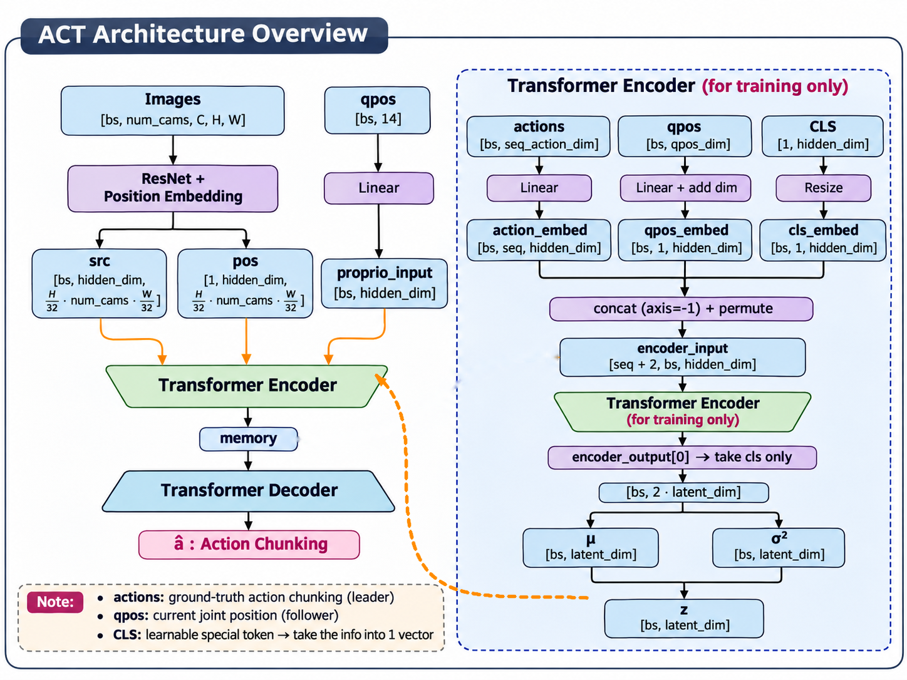
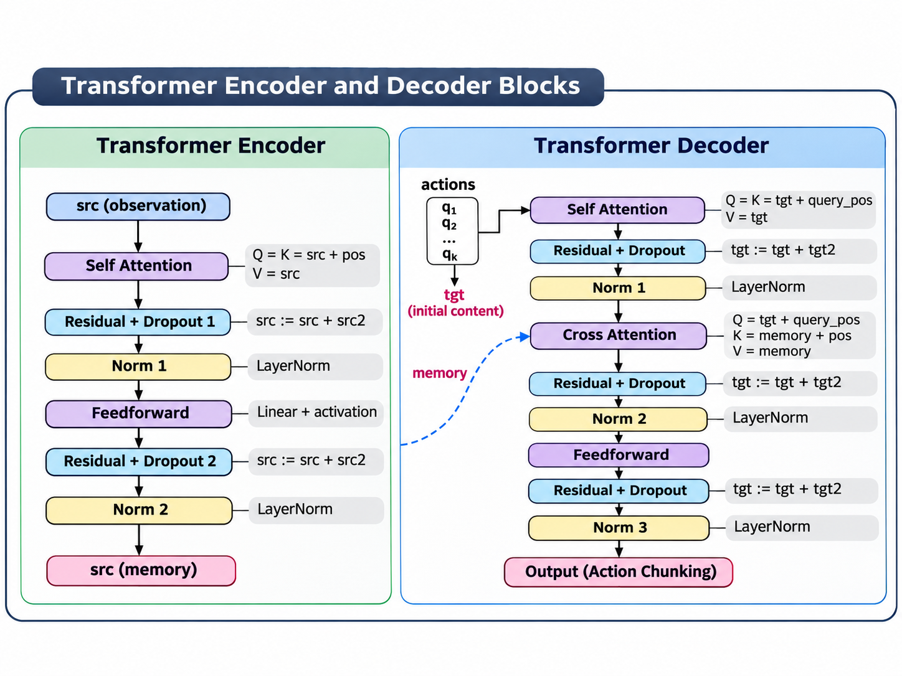
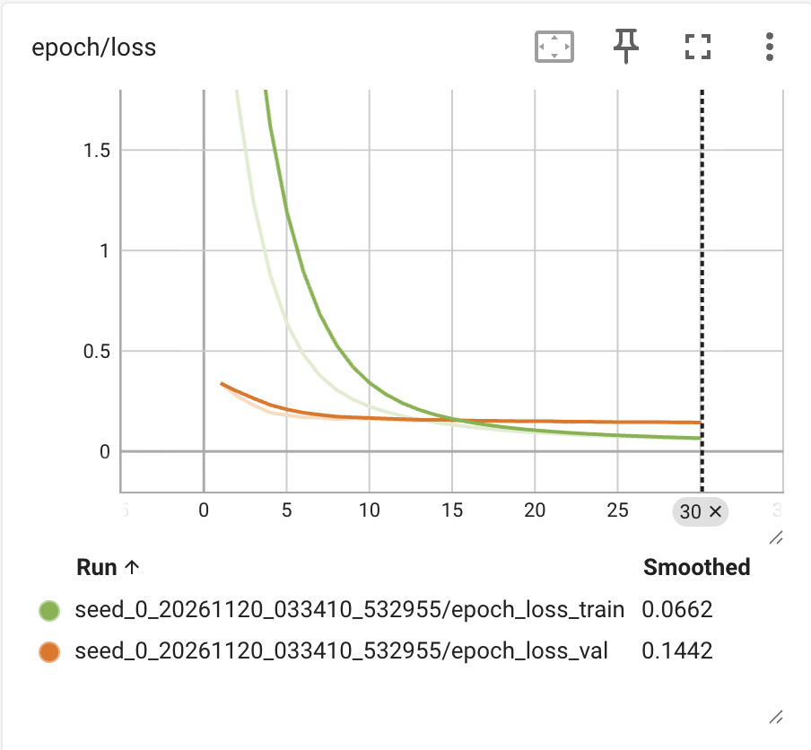
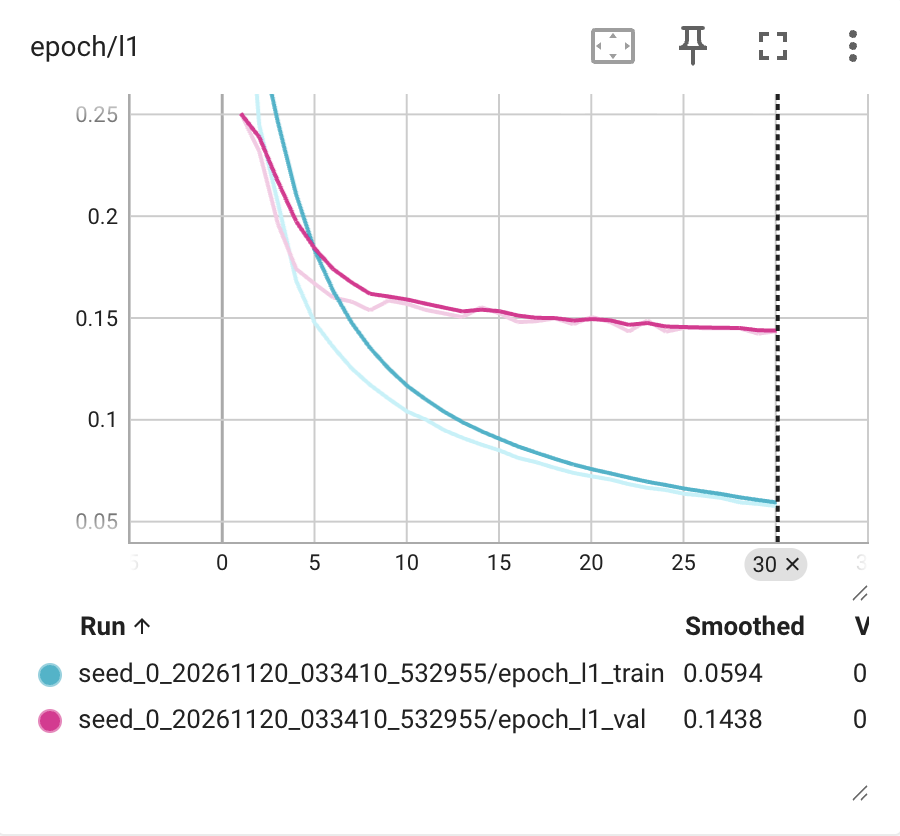
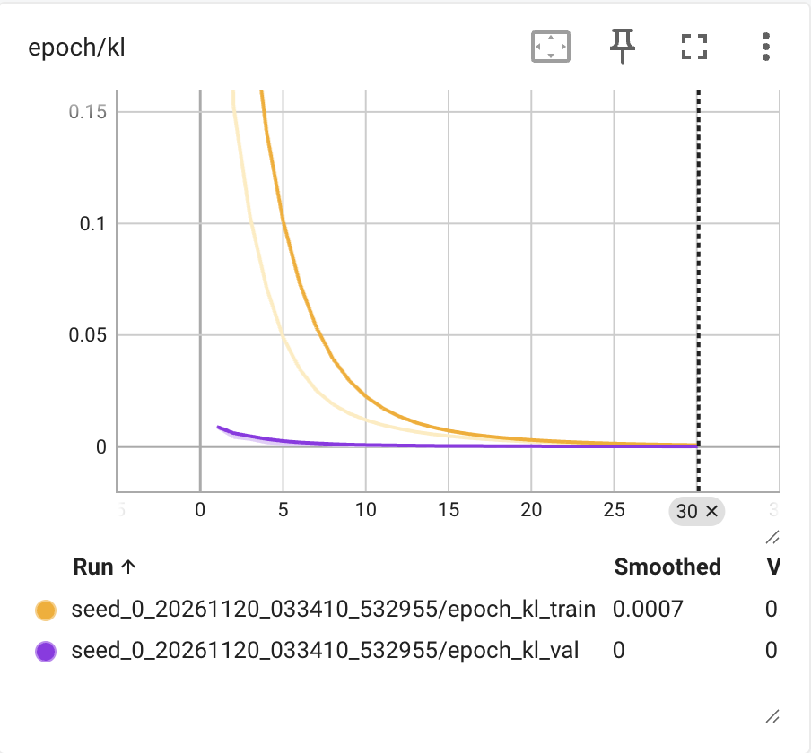
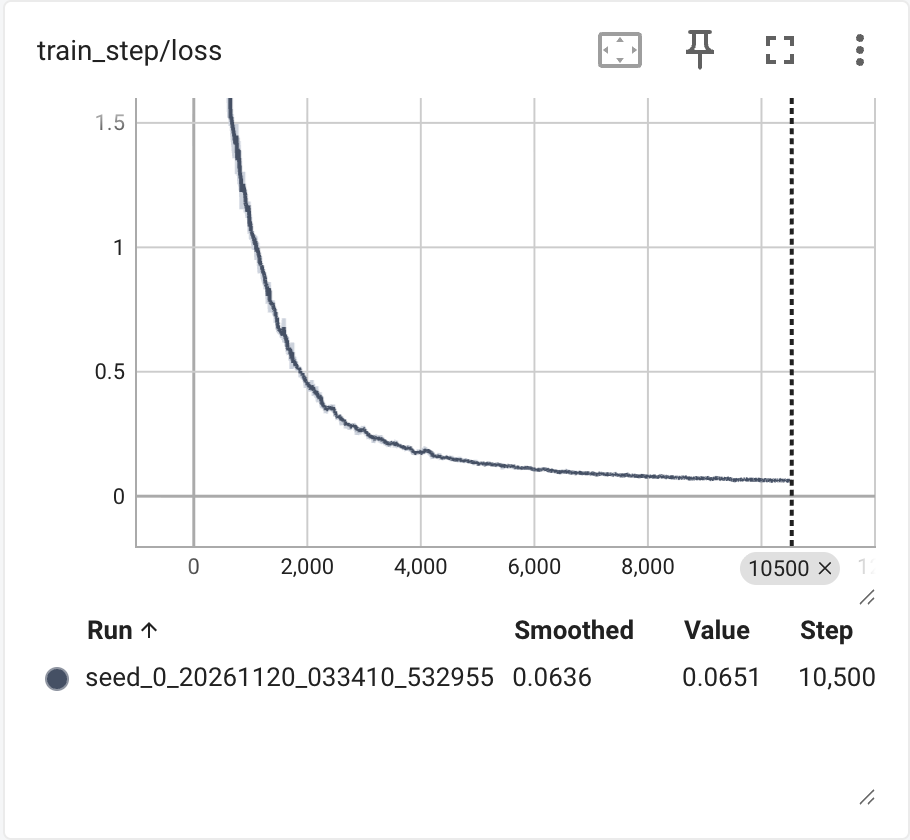
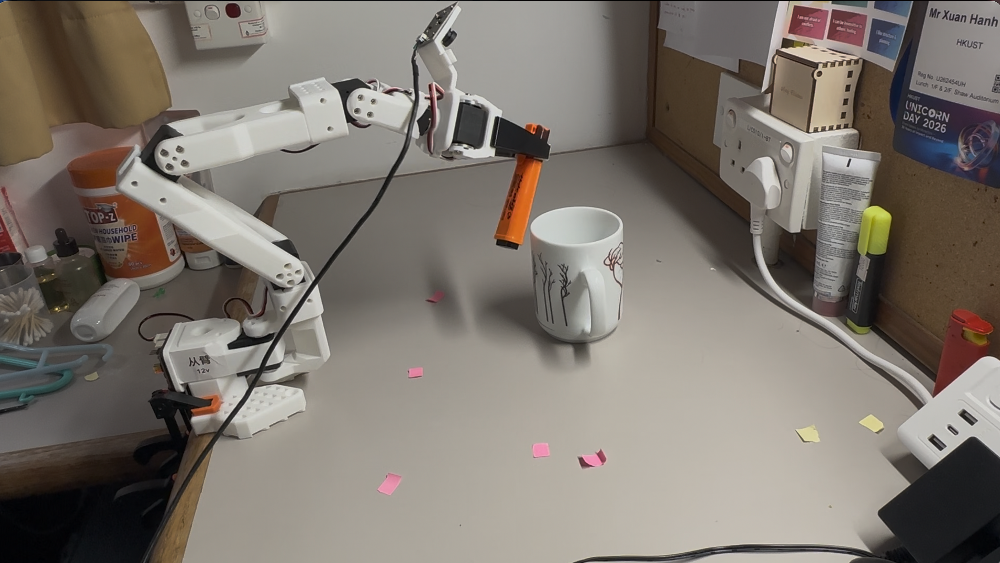
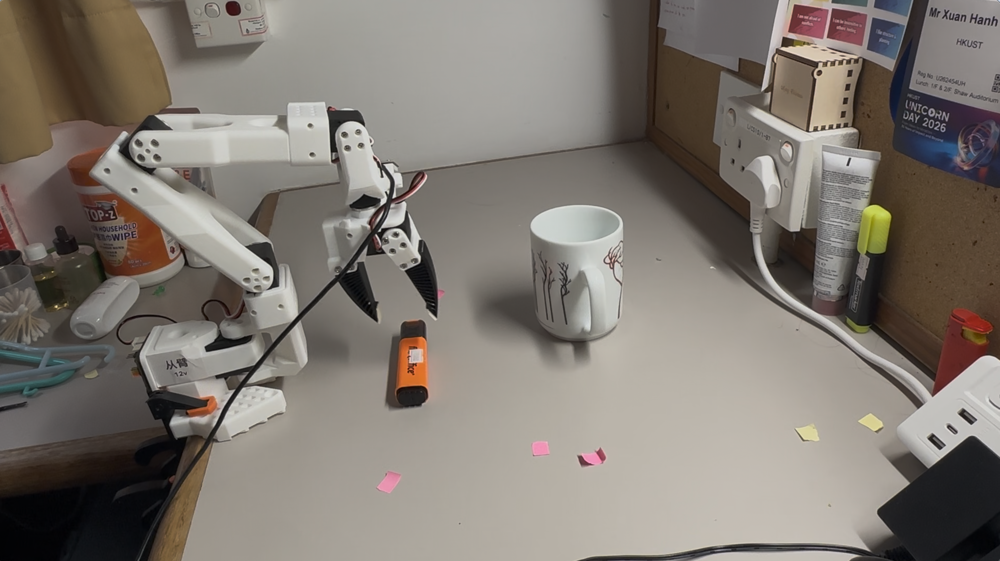

# ACT-Rebuild

**An educational ACT implementation with a complete demonstration, training, and real-robot evaluation workflow for SO-ARM101.**

This project connects front and wrist RGB images and six robot joint positions to chunked action prediction with **Action Chunking with Transformers (ACT)**. It includes leader–follower teleoperation, demonstration recording and review, episodic data loading, a CVAE-based policy, TensorBoard logging, and robot rollout with optional temporal aggregation. LeRobot provides the motor and camera interfaces.

[Training guide](docs/training_guide/README.md) · [Model architecture](#model-architecture) · [Training metrics](#training-metrics) · [Temporal vs no temporal](#temporal-vs-no-temporal) · [Evaluation protocol](docs/evaluation/README.md)

## Model architecture

<table>
  <tr>
    <td align="center">
      <strong>ACT architecture</strong> 
      
    </td>
  </tr>
</table>

The front and wrist images pass through a shared, pretrained **ResNet18** backbone. Projected visual features, positional embeddings, projected robot state, and a latent token enter the policy Transformer encoder. The decoder uses learned action queries to predict a chunk of future joint targets.

During training, a separate CVAE encoder receives a `[CLS]` token, the current joint state, and the demonstrated action chunk. It predicts the mean and log variance of a **32-dimensional latent**; a sampled latent conditions the action predictor. During robot inference, the latent is fixed to **`z = 0`**, and demonstrated future actions are unnecessary.

*The overview is a conceptual illustration. Its `qpos [bs, 14]` label comes from a bimanual configuration; this implementation uses `qpos [B, 6]` and action chunks `[B, K, 6]`. The CVAE token sequence is concatenated along the sequence dimension.*

### Transformer encoder and decoder

<table>
  <tr>
    <td align="center">
      <strong>Self-attention and cross-attention</strong> 
      
    </td>
  </tr>
</table>

Encoder self-attention mixes visual, state, and latent information. Decoder self-attention connects action-query positions, while cross-attention reads the encoder memory. A linear action head maps the final decoder output to six normalized joint targets per timestep; saved action statistics convert these predictions back to robot units. Learned query embeddings encode the action positions; the decoder's initial content tensor is zero.

## Training metrics

**Status: TensorBoard figures and the evaluated run configuration to be added.**

<table>
  <tr>
    <td align="center" width="50%">
      <strong>Training and validation loss</strong> 
      <em>Epoch loss figure to be added.</em>
      <!--  -->
    </td>
    <td align="center" width="50%">
      <strong>Action reconstruction loss</strong> 
      <em>Masked L1 figure to be added.</em>
      <!--  -->
    </td>
  </tr>
  <tr>
    <td align="center">
      <strong>KL divergence</strong> 
      <em>KL figure to be added.</em>
      <!--  -->
    </td>
    <td align="center">
      <strong>Training loss by update</strong> 
      <em>Optimizer-step figure to be added.</em>
      <!--  -->
    </td>
  </tr>
</table>

TensorBoard records total loss, masked action L1, unweighted KL, best validation loss, and learning rates. Epoch charts use completed epochs; batch charts use optimizer updates. Export the raw traces and state any smoothing used. Setup and live viewing commands are in the [training guide](docs/training_guide/README.md#watch-loss-live-in-tensorboard).

### What the losses measure

| Evidence | Interpretation |
| --- | --- |
| Validation L1 + weighted KL | The training objective on held-out episodes, conditioned on a latent inferred from demonstrated future actions |
| Offline action error with `z = 0` | Difference between inference-time predicted chunks and held-out demonstration actions; not yet measured here |
| Real-robot task success | Whether the policy completes manipulation under its own executed actions |

Validation samples a CVAE latent, while robot inference uses `z = 0`. A low validation loss alone does not establish grasp accuracy or placement success. Offline inference-time action evaluation is a planned measurement; a dedicated CLI for it is not implemented.

## Real-robot evaluation

**Status: structured trials, quantitative results, and videos to be added.**

Task success means the robot grasps the marker, lifts and transfers it, and releases it inside the cup within the evaluation horizon, without manual intervention. Record grasp and placement failures separately to distinguish reaching errors from later transfer errors.

### Temporal vs no temporal

Both modes use the **same trained ACT checkpoint**. Temporal aggregation changes rollout behavior and requires no retraining.

| Behavior | No temporal aggregation | Temporal aggregation |
| --- | --- | --- |
| CLI option | Omit `--temporal_agg` | Add `--temporal_agg` |
| Policy query | Once every `K` control steps | Every control step |
| Executed action | Next action in the latest predicted chunk | Weighted average of overlapping predictions for the current timestep |
| Observation feedback | New prediction at each chunk boundary | New prediction at every step |
| Inference workload | One forward pass per chunk | One forward pass per step |

No temporal aggregation still replans at chunk boundaries. Temporal aggregation combines only predictions targeting the **same execution timestep**. The current implementation uses exponential weights with decay `0.01`, ordered from oldest to newest, giving older predictions slightly more weight. Its effect on smoothness, responsiveness, and task success remains to be measured.

This comparison changes both query frequency and aggregation. Report it as a comparison of rollout modes; it does not isolate the effect of averaging alone. The configured control target is 30 Hz, but inference and hardware I/O can reduce the achieved rate, so report the measured rate for each mode.

### Rollout videos

<table>
  <tr>
    <td align="center" width="50%">
      <strong>No temporal aggregation</strong> 
      <em>Pick-and-place video to be added.</em>
      
    </td>
    <td align="center" width="50%">
      <strong>Temporal aggregation</strong> 
      <em>Pick-and-place video to be added.</em>
      
    </td>
  </tr>
</table>

Use matched marker/cup layouts and the same reset pose for the two videos. Include the checkpoint, trial ID, outcome, and playback speed in each caption. Keep failed trials in the quantitative summary even when the featured video is successful.

### Quantitative comparison

| Metric | No temporal aggregation | Temporal aggregation |
| --- | --- | --- |
| Checkpoint / chunk size | Pending | Pending |
| Number of trials | Pending | Pending |
| Task success, successes / trials (%) | Pending | Pending |
| Grasp success, successful grasps / trials (%) | Pending | Pending |
| Completion time, successful trials (s) | Pending | Pending |
| Measured control rate (Hz) | Pending | Pending |
| Main failure modes | Pending | Pending |

Use the same test layouts, checkpoint, normalization statistics, reset pose, step limit, and target-change limit for both modes. Reset the scene between trials and alternate the testing order. The [evaluation protocol](docs/evaluation/README.md) defines the trial log and asset locations.

### Preliminary observations

Informal robot trials showed an initial trajectory deviation followed by replanning toward the marker in both modes. This is a qualitative observation; matched trial counts and videos are needed before concluding whether either mode improves performance or identifying the cause of the deviation.

## Implementation map

| Path | Purpose |
| --- | --- |
| `act/models/` | ResNet backbone, CVAE, Transformer, and positional encoding |
| `act/policy.py` | ACT/CNNMLP policy interfaces and training losses |
| `act/main.py` | Model and AdamW optimizer builders |
| `act/utils.py` | Frame-indexed episodic loader, train-only statistics, and temporal aggregation |
| `act/imitate_episodes.py` | Training, TensorBoard logging, checkpoints, and robot rollout CLI |
| `act/low_level_control.py` | Task configuration and real-robot environment |
| `hardware_constant.py` | Ports, cameras, joint ordering, control interval, and reset pose |
| `teleoperation/` | Teleoperation, NPZ/MP4 recording, and dataset review |
| `docs/` | Architecture diagrams, training guide, and evaluation protocol |

## Current scope

The project currently targets one pick-and-place task with two cameras. Quantitative temporal/no temporal results and independent test-layout generalization have not been established. Task success is scored manually; the runner does not implement an automatic success detector or rollout video saving. Training currently starts a new model on each invocation; resume training is not implemented.

## References and acknowledgments

This project follows ACT and adapts its model structure for learning and experimentation on SO-ARM101.

- [Learning Fine-Grained Bimanual Manipulation with Low-Cost Hardware](https://arxiv.org/abs/2304.13705) — Zhao et al., 2023.
- [ACT reference implementation](https://github.com/tonyzhaozh/act) — original policy and training code.
- [ALOHA project](https://tonyzhaozh.github.io/aloha/) — ACT paper, demonstrations, and hardware context.
- [Hugging Face LeRobot](https://github.com/huggingface/lerobot) — motor and camera interfaces.
- [LeRobot SO-101 setup](https://huggingface.co/docs/lerobot/so101) — hardware setup and calibration.
